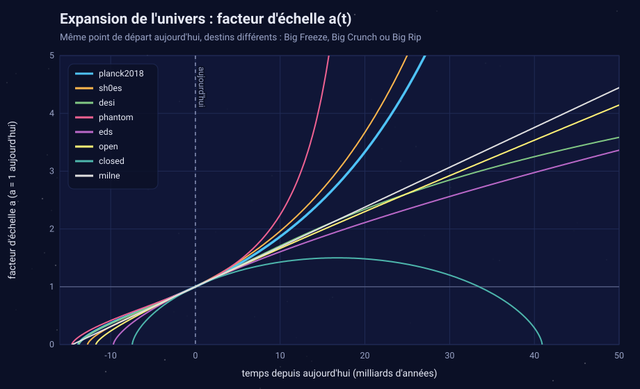
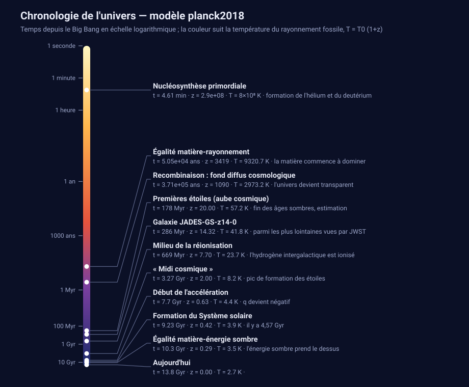
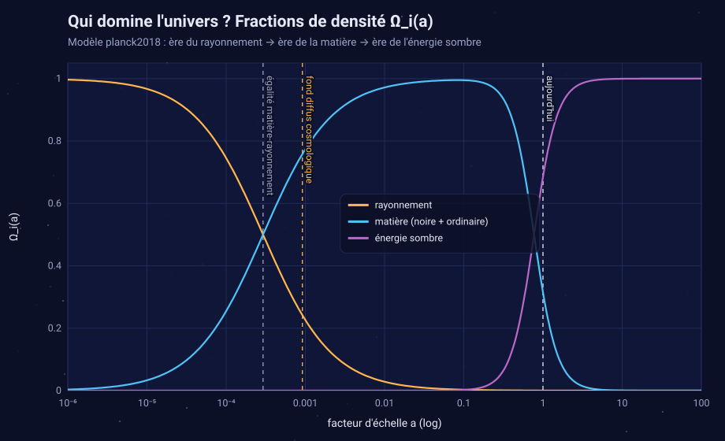
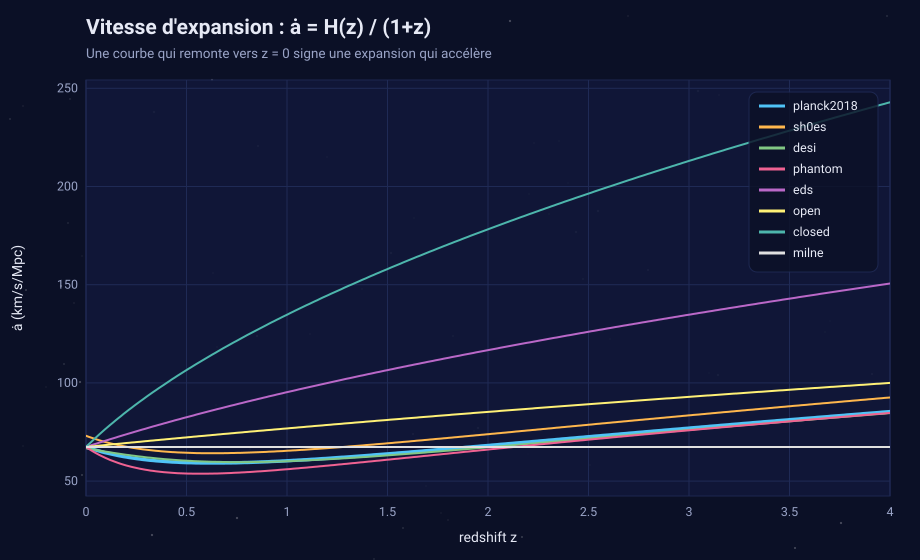
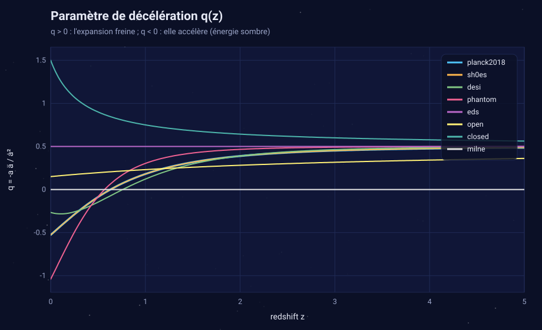
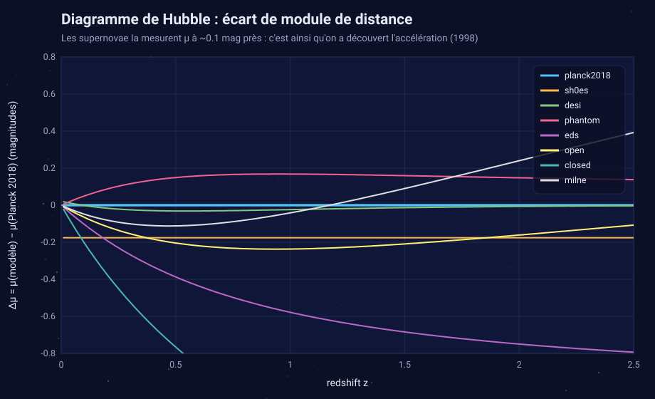
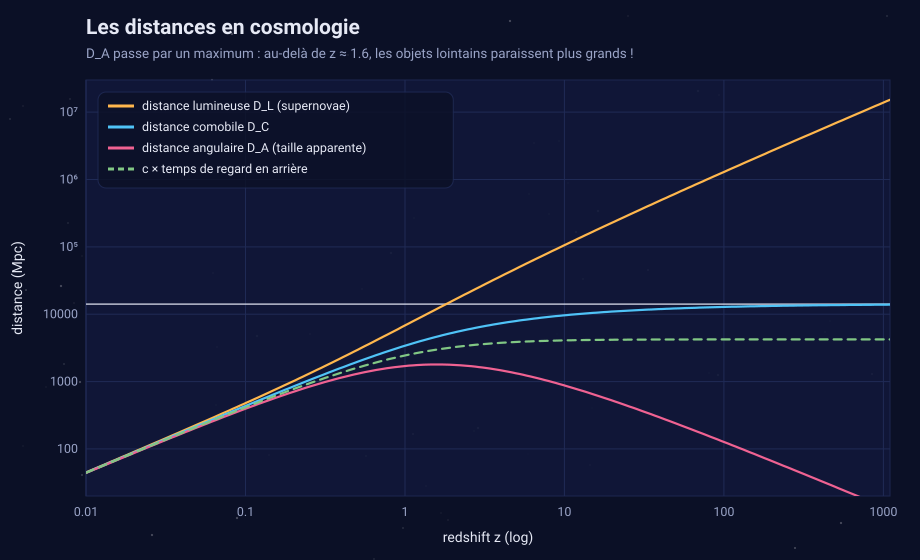
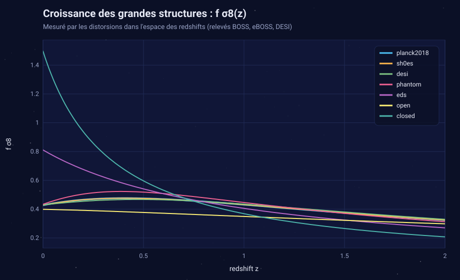
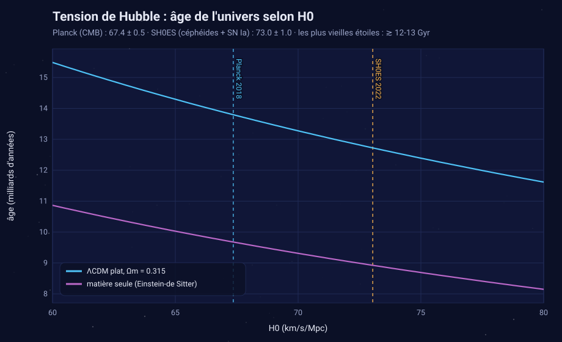

# cosmology_simulation

Programme C++17 qui simule l'expansion de l'univers dans le **modèle standard ΛCDM** et plusieurs extensions récentes : énergie sombre dynamique (DESI), tension de Hubble (SH0ES), énergie fantôme (Big Rip), univers ouverts et fermés. Il n'a aucune dépendance externe. Il affiche les résultats dans le terminal, exporte un CSV et **génère des illustrations SVG ainsi qu'un rapport HTML**.



## Démarrage rapide

```bash
make                     # compile build/cosmology_simulation
make test                # vérifie la physique face aux solutions analytiques
./build/cosmology_simulation                 # modèle Planck 2018
./build/cosmology_simulation --compare       # compare tous les modèles
./build/cosmology_simulation --svg figures   # illustrations + figures/index.html
```

Avec CMake (Linux, macOS, Windows/Visual Studio) :

```bash
cmake -S . -B build && cmake --build build --config Release
ctest --test-dir build -C Release
```

Sans outil de build : `g++ -std=c++17 -O2 -o cosmology_simulation main.cpp Cosmology.cpp SvgPlot.cpp Report.cpp`

## Options

| Option | Rôle |
|---|---|
| `--preset NOM` | modèle prédéfini (`--list` pour les voir) |
| `--H0`, `--Om`, `--OL`, `--Or` | paramètres cosmologiques. Sans `--OL`, l'univers est supposé plat. |
| `--w0`, `--wa` | énergie sombre dynamique : w(a) = w0 + wa (1 − a) |
| `--future GYR` | durée simulée dans le futur (50 Gyr par défaut) |
| `--dt GYR` | pas de la table a(t) |
| `--csv fichier.csv` | export de t, a, z, H, q, Ωᵢ, T_CMB et D(a) |
| `--svg dossier` | 9 illustrations SVG et un rapport `index.html` |
| `--compare` | tableau comparatif de tous les modèles |

Exemples :

```bash
./build/cosmology_simulation --preset desi                 # énergie sombre qui évolue
./build/cosmology_simulation --H0 73 --Om 0.3              # votre propre univers plat
./build/cosmology_simulation --Om 0.3 --OL 0 --future 100  # univers ouvert sans énergie sombre
./build/cosmology_simulation --preset closed --dt 2        # jusqu'au Big Crunch
```

## Modèles prédéfinis

| Nom | Description | Âge | Destin |
|---|---|---|---|
| `planck2018` | ΛCDM plat, Planck 2018 (H0 = 67,36, Ωm = 0,3153) | 13,80 Gyr | Big Freeze |
| `sh0es` | tension de Hubble : H0 = 73,04 (céphéides + supernovae) | 12,72 Gyr | Big Freeze |
| `desi` | w0waCDM, environ DESI DR2 + CMB + SN (w0 = −0,75, wa = −0,86) | 13,76 Gyr | expansion qui ralentit* |
| `phantom` | énergie fantôme w = −1,5 | 14,58 Gyr | Big Rip dans 22,7 Gyr |
| `eds` | Einstein-de Sitter (matière seule) | 9,68 Gyr | expansion qui ralentit |
| `open` | univers ouvert, Ωm = 0,3, sans Λ | 11,74 Gyr | expansion qui ralentit |
| `closed` | univers fermé, Ωm = 3 | 7,45 Gyr | Big Crunch dans 40,9 Gyr |
| `milne` | univers vide, a ∝ t | 14,52 Gyr | vitesse constante |

\* La paramétrisation w0-wa est ajustée sur les données passées (z ≲ 2). La prolonger loin dans le futur relève de la spéculation, mais cela montre bien que **le destin de l'univers dépend de la nature de l'énergie sombre**.

## Physique

L'équation de Friedmann, avec H(a) = H0 · E(a) :

```
E²(a) = Ωr a⁻⁴ + Ωm a⁻³ + Ωk a⁻² + ΩDE · a^(−3(1+w0+wa)) · e^(−3 wa (1−a))
```

- **Rayonnement** : Ωr est calculé à partir de la température du fond diffus (T = 2,7255 K) et de N_eff = 3,046 neutrinos. C'est lui qui domine les premiers 50 000 ans.
- **Trajectoire a(t)** : on intègre l'équation d'accélération ä/a = −(H0²/2) Σ Ωᵢ(a)(1 + 3wᵢ) par Runge-Kutta 4 à pas adaptatif. Cette forme gère correctement le demi-tour d'un univers fermé (Big Crunch) comme la divergence d'un univers fantôme (Big Rip).
- **Âge, temps de regard en arrière et distances** : intégration de Simpson adaptative. Le programme calcule la distance comobile, la distance lumineuse (celle des supernovae), la distance angulaire, le module de distance μ et l'horizon des particules (le rayon de l'univers observable, environ 46 milliards d'années-lumière).
- **Croissance des structures** : D'' + (1 − q) D' = (3/2) Ωm(a) D, résolue avec une condition initiale de Mészáros exacte. On en tire f = d ln D / d ln a et **f σ8(z)**, la quantité que mesurent les relevés de galaxies.
- **Époques clés** : égalité matière-rayonnement, recombinaison, début de l'accélération (q = 0), égalité matière-énergie sombre.

### Validation

`make test` compare la simulation à des solutions exactes :

| Test | Précision |
|---|---|
| Einstein-de Sitter : âge 2/(3H0), a ∝ t^(2/3), D(a) = a, distances | ≤ 10⁻⁶ |
| Milne : âge 1/H0, D_L = (c/H0) z (1 + z/2) | ≤ 10⁻⁸ |
| Planck 2018 : âge 13,797 Gyr (valeur publiée) | 0,02 % |
| Univers fermé : instant du Big Crunch (solution cycloïde) | 0,008 % |
| Cohérence : a(t0) = 1 et H(t0) = H0 après intégration RK4 | ≤ 10⁻⁵ |

## Illustrations

`--svg dossier` génère les figures ci-dessous, régénérables avec `make figures` :

| | |
|---|---|
|  |  |
| **Chronologie** : de la nucléosynthèse (3 min) à aujourd'hui, avec la température du rayonnement | **Qui domine ?** Les ères du rayonnement, de la matière puis de l'énergie sombre |
|  |  |
| **Vitesse d'expansion** ȧ : son minimum marque le début de l'accélération | **Paramètre de décélération** q(z) |
|  |  |
| **Diagramme de Hubble** : ce que voient les supernovae Ia | **Distances** : D_A passe par un maximum vers z ≈ 1,6 |
|  |  |
| **Croissance des structures** f σ8(z) | **Tension de Hubble** : H0 fixe l'âge de l'univers |

## Structure du code

| Fichier | Contenu |
|---|---|
| `Cosmology.h/.cpp` | modèle physique : Friedmann, intégrateurs, distances, croissance, époques, modèles prédéfinis |
| `SvgPlot.h/.cpp` | petit moteur de graphiques SVG (axes linéaires ou logarithmiques, légende, repères) |
| `Report.h/.cpp` | figures, chronologie, export CSV, rapport HTML, graphique ASCII |
| `main.cpp` | interface en ligne de commande |
| `tests/test_cosmology.cpp` | tests de validation physique |

## Idées pour aller plus loin

- **Ajuster les paramètres sur de vraies données** : charger le catalogue de supernovae Pantheon+ ou les mesures BAO de DESI, puis estimer H0, Ωm, w0 et wa par moindres carrés ou MCMC.
- **Neutrinos massifs** : ils passent du comportement « rayonnement » au comportement « matière », ce qui change légèrement H(z) et la croissance.
- **Oscillations acoustiques de baryons (BAO)** : calculer l'horizon sonore r_d ≈ 147 Mpc et prédire D_M/r_d et D_H/r_d, pour comparer directement avec DESI.
- **Spectre de puissance P(k)** : fonction de transfert d'Eisenstein-Hu, σ8 et nombre d'amas de galaxies attendus.
- **Simulation N-corps** : un petit code particule-maillage 2D ou 3D qui utilise a(t) pour montrer la formation de la toile cosmique.
- **Inflation** : un champ scalaire dans un potentiel V(φ) pour simuler les premiers 10⁻³² s.
- **Interface interactive** : curseurs Ωm, ΩΛ, w, avec le graphique a(t) mis à jour en direct (par exemple en WebAssembly avec Emscripten).
- **Horizon des événements cosmologique** : la région de l'univers que nous ne pourrons jamais atteindre, même à la vitesse de la lumière.

## Limites

Le modèle est homogène et isotrope (métrique FLRW). Il ne traite ni les perturbations non linéaires, ni la physique des particules des premiers instants, ni les neutrinos massifs. Les dates des premières étoiles et de la réionisation proviennent d'estimations observationnelles, converties en âge pour chaque modèle.

## Licence

GPL-3.0, voir [LICENSE](LICENSE).
